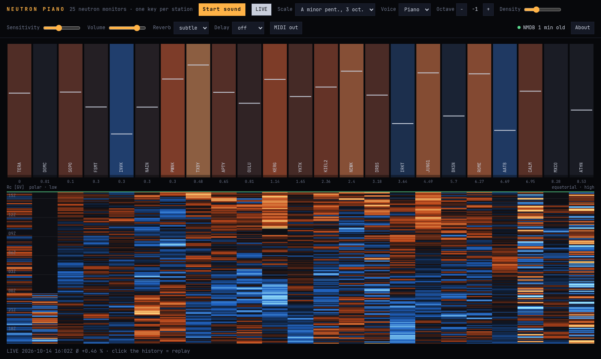

# Neutron Piano

**Listen to cosmic rays in real time.** 25 neutron monitors around the world, one piano key each. The more particles a station counts, the more often and the harder its key is struck. When a solar storm shields Earth from cosmic rays, the keyboard falls quiet.

**Live demo: [sponde.de/neutron-piano](https://sponde.de/neutron-piano/)**



- Live 1-minute data from the [Neutron Monitor Database (NMDB)](https://www.nmdb.eu)
- Keys ordered by geomagnetic cutoff rigidity: polar stations play low notes, equatorial stations play high notes
- 24-hour waterfall with click-to-replay
- Piano, harp and bell voices, scales, octave shift, reverb, delay
- MIDI out via Web MIDI, to drive any synth or DAW
- A single HTML file plus a ~100-line proxy, with no build step and no dependencies

An in-page **About** overlay explains everything for visitors, including a section with the details for the detector community.

## Quick start

```sh
git clone https://github.com/Kracht/neutron-piano.git && cd neutron-piano
python3 serve.py            # http://localhost:8765/
```

`serve.py` uses only the Python standard library. Open the page, press **Start sound**.

## Deploy

Any PHP web host works: upload `index.html` and `nmdb.php`.

A proxy is needed because NMDB sends no CORS headers and returns its data as an HTML-wrapped table. `nmdb.php` (and `serve.py`, which answers the same `/nmdb.php` route) fetch NMDB server-side, parse the table to JSON and cache it for 55 s. The upstream URL is fixed and the only parameter is `days` (clamped to 1–7), so neither is an open proxy. `nmdb.php` uses curl if available, otherwise `allow_url_fopen`.

## How it works

| Step | What happens |
|---|---|
| Data | NMDB real-time 1-min counts, revised where available, otherwise original, corrected for pressure and efficiency, last 24 h, refreshed every minute |
| Smoothing | 15-min trailing mean per station |
| Deviation `d` | Smoothed rate vs. the station's own 24-h median, in % (colour scale ±2 %) |
| Strike rate | `λ = 0.35 s⁻¹ · density · exp(k · d)`, `k` = sensitivity (default 0.4), `d` clamped to ±8 %, sampled as a Poisson process every 20 ms |
| Velocity | random 0.45–1.0 × `(1 + d/4)` |
| Pitch | rank by cutoff rigidity, mapped to scale steps; default A minor pentatonic over three octaves, shifted one octave down |

Because the baseline is a running 24-h median, the piano plays departures from the past day, not absolute flux. Slow trends such as the solar cycle drop out, and Forbush decreases lasting longer than about half a day are partly absorbed into the baseline.

## Controls

| Control | Function |
|---|---|
| Scale | A minor pentatonic over 3 octaves (default), or minor/major pentatonic, Hirajoshi, whole tone, major over 25 steps |
| Voice | Piano (additive), Harp (Karplus-Strong plucked string), Bell (sine) |
| Octave − / + | −3 to +2, default −1 |
| Density, Sensitivity, Volume | Note count, response to deviations, level |
| Reverb | off, subtle, wide |
| Delay | off, short (240 ms), long (520 ms), low-passed feedback |
| MIDI out | Output port, channel 1–16, internal synth on/off |
| History | Click or drag to replay at 15 min/s, LIVE returns to now |

### MIDI out

Every strike sends a note-on with the scale note's MIDI number (octave shift included) and a velocity from the strike strength. The note-off follows after the voice's decay; for piano and harp it comes after 2 s at most. Pausing, switching port or channel, or turning MIDI off releases all held notes.

Web MIDI needs a secure context (https or `localhost`) and a supporting browser: Chromium-based browsers, or Firefox, which asks for permission. Safari does not support it.

## Limits

- The cutoff rigidities in `RC` (in `index.html`) are approximate vertical cutoffs and do not follow the secular change of the geomagnetic field.
- Only the last 24 h are kept, and there is no persistent archive.
- Stations without data in the last 30 minutes stay silent. NMDB latency differs from station to station.
- Browsers throttle timers in background tabs. For an installation, keep the page in the foreground.

## Acknowledgements

We acknowledge the NMDB database ([www.nmdb.eu](https://www.nmdb.eu)), founded under the European Union's FP7 programme (contract no. 213007), for providing data. The data of each neutron monitor are provided by the institute that operates it.

## License

Code: [MIT](LICENSE). The neutron monitor data are not covered by this license; they belong to the NMDB stations and their operating institutes, see Acknowledgements.
